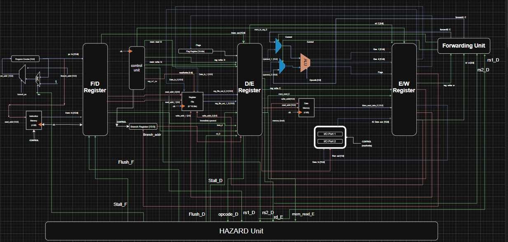

# MINI-RISC-Pipeline

A hardware implementation of a 4-stage pipelined RISC processor designed in synthesizable Verilog. This architecture optimizes instruction throughput by implementing dedicated hardware hazard mitigation and data forwarding paths to handle control and data dependencies cleanly.

## Key Features

* **4-Stage Pipeline**: Parallel processing across specialized functional stages to maximize execution throughput.
* **Full Data Forwarding**: Dedicated Forwarding Unit to resolve data hazards dynamically without stalling when possible.
* **Comprehensive Hazard Management**: Integrated Hazard Unit executing precise flushing and stalling operations.
* **Dedicated I/O Interface**: Integrated I/O Port 1 and Port 2 for direct peripheral interaction.

## Repository Structure

```text
├── src/               # Synthesizable Verilog source files (.v) and Verification Testbenches
└── README.md          # Project documentation
```

## 📊 Microarchitecture & Pipeline Stages



The processor separates instruction execution into four explicit stages divided by distinct pipeline registers:
[ Fetch ] ──▶ (F/D Register) ──▶ [ Decode ] ──▶ (D/E Register) ──▶ [ Execute ] ──▶ (E/W Register) ──▶ [ Writeback/Mem ]
1. **Fetch (F)**
   * Utilizes a Program Counter (PC) with an incremental addition loop.
   * Pulls instructions from the dedicated **Instruction Memory** unit.
   * Can be stalled (`Stall_F`) or cleared (`Flush_F`) depending on pipeline hazards.

2. **Decode (D)**
   * Separated by the **F/D Register**.
   * Contains the centralized **Control Unit** for decoding operation codes (`opcode_D`).
   * Includes the **Register File** (`8 × 16-bit`) with dual source registers (`rs1_D`, `rs2_D`).
   * Evaluates branch logic using a dedicated **Branch Register** and calculates target branch addresses (`Branch_addr`).

3. **Execute (EX)**
   * Separated by the **D/E Register**.
   * Features an internal **ALU** (Arithmetic Logic Unit) driven by multiplexed operands.
   * Interacts with local **Data Memory** (RAM) block for storage operations.

4. **Writeback / Memory (WB)**
   * Separated by the **E/W Register**.
   * Commits computed results or loaded memory data directly back to destination registers (`rd_E`).
   * Integrates an independent dual **I/O Port** block (`I/O Port 1` & `I/O Port 2`) for external peripheral data mapping.

## Hazard & Control Mechanics

The design features specialized hardware protection modules to guarantee deterministic operation under conflicts:

* **Forwarding Unit**: Tracks source registers against downstream write-back configurations to feed operand results directly back to the ALU inputs, eliminating data delays.
* **HAZARD Unit**: Monitors pipeline dependencies continuously. It directly manages pipeline control lines:
  * `Stall_F` / `Stall_D`: Holds instruction steps when data dependencies cannot be resolved by forwarding alone.
  * `Flush_F` / `Flush_D`: Flushes instruction lines immediately following an invalid branch prediction or control change.

## FPGA Synthesis, Timing & Resource Utilization

Synthesized and implemented on an **Intel Cyclone V FPGA (`5CSEMA5F31C6`, Terasic DE1-SoC)** using **Quartus Prime 20.1 Lite Edition** with a 50 MHz (`20.000 ns`) primary clock constraint.

### Resource Utilization (`Fitter Summary`)

| Resource | Used | Available | Utilization |
| :--- | :--- | :--- | :--- |
| **Logic Utilization (ALMs)** | 954 | 32,070 | **3%** |
| **Dedicated Logic Registers** | 394 | 64,140 | **< 1%** |
| **M10K Block Memory** | 8 blocks (65,536 bits) | 397 blocks (4,065,280 bits) | **2%** |
| **DSP Blocks** | 1 | 87 | **1%** |
| **I/O Pins** | 67 | 457 | **15%** |
| **Average Interconnect Usage** | — | — | **1.2%** |

* **Memory Architecture:** Inferred **8 M10K blocks** (`65,536 bits` total) supporting separate 16-bit Instruction ROM and Data RAM blocks.
* **Arithmetic Acceleration:** Inferred **1 dedicated DSP block** for 16×16 multiplication (`MUL`).

### Multi-Corner Static Timing Analysis (`50 MHz` Target Clock)

| PVT Corner | Worst-Case Setup Slack | Worst-Case Hold Slack | Status |
| :--- | :--- | :--- | :--- |
| **Slow 1100mV 85°C** *(Worst Setup)* | **+10.044 ns** | +0.609 ns | **PASS (~100.4 MHz Fmax)** |
| **Slow 1100mV 0°C** | +10.077 ns | +0.581 ns | **PASS** |
| **Fast 1100mV 85°C** | +13.627 ns | +0.242 ns | **PASS** |
| **Fast 1100mV 0°C** *(Worst Hold)* | +14.159 ns | **+0.220 ns** | **PASS** |

* **Maximum Operating Frequency (`Fmax`):** **~100.4 MHz** (`9.956 ns` critical path delay at Slow 1100mV 85°C), providing over **2× timing margin** at the DE1-SoC's 50 MHz onboard clock.

## 🛠️ Getting Started

### Tools Needed
* **Simulation**: [Icarus Verilog (iverilog)](https://github.io)
* **Waveforms**: [GTKWave](http://sourceforge.net)

## 📄 License
This project is licensed under the MIT License.
